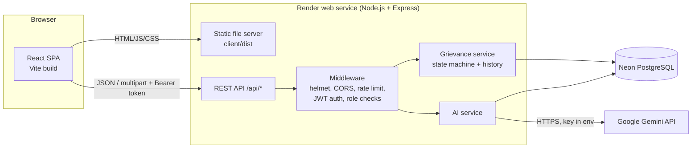

# 02. System Architecture

## Overview
A three-tier web application served from a single Node.js process.

## Components
**Frontend (`client/`)** React 18 single-page app built with Vite. React Router handles navigation; `auth.jsx` keeps the logged-in user; `api.js` adds the JWT to every request. Recharts draws the CMO charts. Role-guarded routes (`RequireRole`) keep each dashboard to its own role.

**Backend (`server/`)** Express 5 REST API.
- `routes/` thin HTTP layer: parse input, call a service, return JSON.
- `services/grievanceService.js` all write-side business rules. Every function runs in one database transaction, locks the grievance row, validates the action and writes `grievance_history`.
- `services/queries.js` read-side queries with per-role visibility rules (what a citizen, officer or CMO may see).
- `services/aiService.js` AI analysis, output validation, fallback and duplicate detection.
- `middleware/auth.js` JWT verification and `allow(...roles)` role-based access control.
- `utils/uploads.js` multer (memory storage, 5 MB, 3 files) plus magic-byte validation.

**Database** PostgreSQL on Neon. Files are stored in the database (`BYTEA`) because free hosting disks are ephemeral.

**AI** Gemini `generateContent` REST API with a JSON response schema. See `05_AI_Integration.md`.

## Request flow example (CMO forwards a grievance)
1. Browser sends `POST /api/cmo/grievances/12/assign` with the JWT.
2. `authenticate` verifies the token and reloads the user; `allow('cmo')` checks the role.
3. `assignGrievance` opens a transaction, locks the row, moves Submitted -> Under Review -> In Progress through the single `transition()` function (two history rows), deactivates any old assignment, inserts the new one, commits.
4. The citizen's tracking page now shows the new history rows.

## Security design
- Passwords hashed with bcrypt; JWT signed with a secret from the environment, 8-hour expiry.
- Public registration can only create **citizens**; staff accounts exist only via the seed.
- Role checks on every protected route; record-level checks (a citizen sees only their own grievances, an officer only their department's). Unauthorised record access returns 404, not 403, so existence is not leaked.
- Parameterised SQL everywhere (no string-built queries with user input).
- helmet security headers, request size limit, rate limits on login/registration, contact form and AI endpoint.
- Uploads: type allow-list, 5 MB limit, content signature check, safe file names, served only through a role-checked endpoint.
- AI output is treated as untrusted and validated; complaint text is fenced as data in the prompt.
- No secrets in the repository (`.env` is git-ignored; `.env.example` has no real values).

## Deployment architecture
One Render web service builds the React app, then Express serves both `/api/*` and the built files, so there is a single URL and no CORS configuration. The database is Neon (Singapore). Environment variables are set in the Render dashboard.
