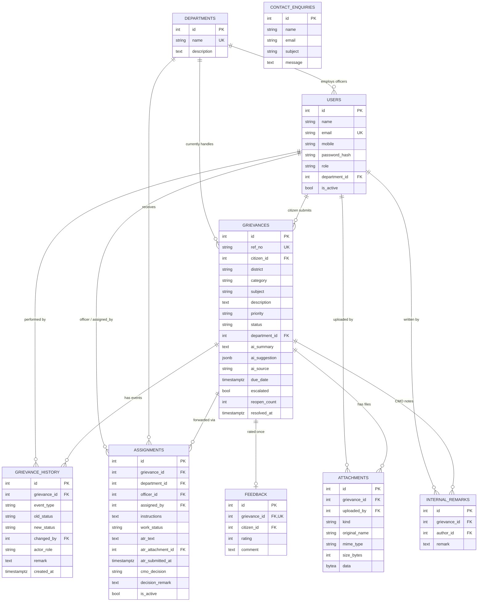

# 03. Database Design

PostgreSQL. Full DDL: [`server/src/db/schema.sql`](../server/src/db/schema.sql).

## ER diagram

## Tables
| Table | Purpose |
|---|---|
| `users` | Citizens, CMO administrators and department officers (`role`). An officer must have a `department_id` (CHECK constraint). Emails are stored lower-case and are unique. |
| `departments` | Government departments (name, description). |
| `grievances` | One row per grievance: reference number, district, category, subject, description, priority, status, current department, AI output, deadline, escalation flag, reopen count. |
| `grievance_history` | Append-only trail of every event (`created`, `status_change`, `assignment`, `officer_remark`, `atr_submitted`, `atr_rejected`, `escalation`, `priority_change`, `feedback`) with old/new status, actor, role, remark, timestamp. |
| `assignments` | Forwarding to a department/officer, CMO instructions, officer work status (`Assigned`, `Investigating`, `ATR Submitted`), the action-taken report and the CMO's decision on it. |
| `attachments` | Files (`kind` = evidence or atr) stored as `BYTEA`. |
| `feedback` | One citizen rating (1 to 5) and comment per grievance. |
| `internal_remarks` | CMO-only notes, never returned to citizens. |
| `contact_enquiries` | Messages from the public Contact form. |

## Relationships
- A department has many officers; a citizen has many grievances.
- A grievance has many history events, assignments (one active at a time), attachments and internal remarks, and at most one feedback.
- `grievances.department_id` is the department currently handling it; the full forwarding history is in `assignments`.

## Design decisions
- **Traceability:** `grievance_history` is written inside the same transaction as every change, by one service layer, so no code path can change a grievance silently.
- **Integrity in the database:** CHECK constraints for roles, statuses, priorities, ratings; a partial unique index (`uq_active_assignment`) allows only one active assignment per grievance; `UNIQUE(grievance_id)` on feedback.
- **Reference numbers:** `CMK-<year>-<6 digits>` from a PostgreSQL sequence, so they are unique even under concurrent submissions.
- **Overdue** is computed (`status <> 'Resolved' AND due_date < now()`), not stored, so it can never go stale.
- **Indexes** on status, district, category, citizen, department and history lookups for the dashboard filters.
- **Files in the database** keep the app stateless and deployable on free hosting; the trade-off is size (limited to 5 MB per file).
